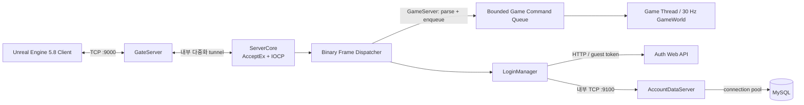

# MyRpgServer

2026-11-01 저장소 배포본은 형제 `Client`, `FirebaseAdmin` 구조를 사용합니다. 소스 포함 범위·외부 의존성과 새 checkout 실행은 [설치 안내](../docs/SETUP.md), 이번 실행 결과는 [업로드 검증](../docs/REPOSITORY_VALIDATION.md)을 따릅니다. 개발 이력의 절대 경로와 산출물은 별도 준비가 필요합니다.

2026-10-28 [UE 네이버 로그인](docs/NAVER_GAME_LOGIN.md): Firebase Admin Web/AccountDataServer/
LoginServer/GateServer와 최신 UE 모듈을 함께 사용한다. UE `[RPG.Auth] WebBaseUrl`과 네이버 등록
콜백 origin을 맞춘다. 웹에 loopback ID Token verifier를 추가했으며 DB migration은 없다.
실제 외부 계정 종단/Android/공개 TLS 배포는 검증 필요다.

2026-10-28 [네이버 웹 인증](docs/NAVER_AUTH_WEB.md): Firebase Admin Web은 Node.js 22.14 이상에서
스크립트 옆 .env를 자동 로딩한다. 기존 ServerManager 실행 설정을 유지하고 기본 HOST는 127.0.0.1이다.
네이버 OAuth/Custom Token 교환 API와 `npm test`, 실제 브라우저 확인용 `Scripts/TestNaverAuth.ps1`을 추가했다.
UE/게임 계정 로그인은 연결 전이며 서버 wire/DB 변경은 없다.

2026-10-28 [UE Windows/Android 빌드 관리](<../Client/Docs/PLATFORM_BUILDS.md>):
하나의 `RPG.uproject`에서 `Scripts/BuildClient.ps1 -Platform Windows|Android -Action Check|Build|Package`로
플랫폼 설정·의존성과 출력 폴더를 나눈다. 기본 Action은 파일 검사다. 2026-10-30 이 PC의 UE 5.8.2
Android 구성요소·SDK 36·Build Tools 36.0.0·NDK r27c를 설치하고 Android C++/Gradle APK 빌드를 통과했다.
ASTC 전체 콘텐츠의 cook/stage/Gradle/package/archive와 최종 APK 서명 검사도 종료 코드 0이다.
산출물은 클라이언트 `Saved/Builds/Android_ASTC/Development`의 APK+OBB+설치 배치이며 실기기 동작은 검증 필요다.
XGE 셰이더 작업 실패 환경에서는
`-Action Package -NoXGEShaderCompile`을 사용한다. 기존 SDK/NDK와 전역 환경변수, 서버 설정은 유지한다.

2026-10-20 [전투 표현](docs/COMBAT_PRESENTATION.md): UE 클라이언트는 엔진 제공 ProceduralMeshComponent
runtime plugin/module과 새 Combat/UI 에셋을 사용한다. 게임은 `RPG.uproject`로 실행하며,
`CodexCombatArtBuild.uproject`는 재질·생성 이미지 수입용 helper다. 서버 빌드/환경 변수 변경은 없다.

2026-10-19 [WorldDataServer와 world_db](docs/WORLD_DATA_SERVER.md): 맵 identity와 GameServer 가동 lease를 별도 DB에 저장한다.
Game은 등록/갱신/해제하고 Login은 선택 전 가동 상태를 조회한다. Manager 배포 프로필과 실행 파일에 반영했다.
위치·HP/MP·던전 회차 저장과 다중 Game 이전은 미구현이며, 이번 검사·로그·한계는 연결 문서를 따른다.

2026-10-18 후속 [벽 알파·바닥 클릭](docs/WALL_CAMERA_FADE.md): UE의 새 `/Game/RPG/Camera/M_WallFade`와
벽 태그를 저장한 `L_Dungeon_01`을 코드와 함께 사용한다. RPGEditor 빌드 후 클라이언트/에디터를 재실행한다.
서버 데이터/프로토콜 변경 및 서버 재시작은 필요하지 않다.

2026-10-18 [카메라 가림·UI 프레임 수정](docs/CAMERA_UI_VISIBILITY.md): UE의 r.CustomDepth=3과
새 `/Game/RPG/Camera/M_PlayerVisibility` 에셋/AlwaysCook 설정을 함께 사용한다.
RPGEditor 빌드 후 클라이언트/에디터를 다시 실행한다. 이번 변경은 서버 재시작/DB 변경이 필요하지 않다.

2026-10-18 [대형 보스·표면 사거리](docs/LARGE_MONSTER_COMBAT.md): Megaspikan 외형을3배(scale0.15),
보스룸을48m×48m로 확대했다. Dungeon01 map301/v3의 북쪽 아레나(1800,-8400)를 양쪽 통로로 연결한다.
서버/UE가 고정 몸통 크기를 공유해 근접 사거리·클릭 접근·투사체·범위 공격·몸통 이동 차단에 사용한다.
검증 범위와 배포/복구는 연결 문서를 따른다.

Monsters.tsv에 bodyRadiusCm/bodyHeightCm/solidRadiusCm 열을 추가했다. SyncCombatData 후 서버/Gate/UE를 함께 갱신한다.
Manager source/배포/Debug/Release와 UE registry는 Dungeon01-v3를 사용한다. 기존 v2 패키지는 과거 fixture로 보존하며 새 GameServer에서는 v2를 거부한다.

2026-10-17 [HP5000·포션](docs/POTIONS.md): 마을 상인에게 HP 포션을 구매하고 가방 Use 또는 숫자3으로 사용한다.
Consumables.tsv를 포함한 SyncItemData.ps1 동기화 후 CharacterData/Game/Gate/UE를 함께 갱신한다. DB migration은 추가하지 않았다.

2026-10-17 [Megaspikan 보스](docs/MEGASPIKAN_BOSS.md): 개인 Dungeon01 중간 보스방에서 기본공격 없는 스킬 패턴을 사용한다.
GameData/Combat/SkillVisuals.tsv도 SyncCombatData.ps1로 동기화하며 서버/Gate/UE를 함께 갱신한다.

2026-10-17: [미로 전투방 던전](docs/DUNGEON_MAZE.md)을 Dungeon01 map301/v2로 적용했다.
서버 `artifacts/Dungeon01-v2/world.rpgworld`와 UE `Content/RPG/WorldData/Dungeon01-v2`를 함께 사용한다.
World kind32가 추가되어 Gate/Game/UE를 함께 빌드해야 한다. Manager source/배포/Debug/Release의
던전 manifest를 v2로 동기화했다. 이미 열린 Manager는 전체 중지 → 설정 다시 읽기 → 전체 시작 후 재접속한다.
보스는 빈 방만 있고 통로 출구 불이익은 아직 미정이다.

2026-10-16: [전투·스킬·NPC 패턴](docs/COMBAT_SYSTEM.md)을 추가했다. 전투 정본은
`GameData/Combat/*.tsv`; 서버 시작 때 `RPG_COMBAT_DATA_ROOT`(기본 `GameData/Combat`)를 읽는다.
`Tools/SyncCombatData.ps1`로 UE의 `Content/RPG/WorldData/Combat` 및 NPC 테이블을 동기화한다.
GameServer 빌드는 실행 폴더에 전투 TSV도 복사한다. ServerManager source/배포/Debug/Release
프로필에 `{RepoRoot}\GameData\Combat` 경로를 추가했다. 실행 중 Manager는 설정을 다시 읽은 뒤 서버를 재시작해야 한다.
이전 바이너리는 새 World kind29~31을 지원하지 않으므로 서버/Gate/UE를 함께 빌드한다.
공용 C++ 빌드는 `/utf-8`을 명시해 Windows 코드 페이지에 따른 소스 오해석을 막는다.


2026-10-15 배포 설정 보정: 실제 실행 파일 `artifacts/ServerManager/RpgServerManager.exe`는
옆의 `servers.json`을 우선 읽는다. 해당 배포본이9/29 설정에 머물러 던전 manifest와 경제flag가
빠져 있던 문제를 수정했다. source/Debug만 갱신한 것으로 배포 완료를 판단하지 않는다.
환경 동기화는 `Tools/SyncServerManagerProfiles.ps1`; 기존 별도 환경 키는 보존하며 백업한다.
실행 중 Manager는 **전체 중지 → ↻(설정 다시 읽기) → 전체 시작** 후 다시 접속해야 한다.
상세 원인/이번 재현·검증은 [NPC 워프](docs/NPC_DIALOGUE_WARP.md)의10/15 배포 기록을 따른다.

2026-10-15: NPC 구매·영속 Gold/가방·장착을 추가했다. Village Merchant1002는 마을
(-6180,-775,516)에 있다. 가까이서 E로 상점, I로32칸 가방을 열고 검/Peasant/Ranger를 장착한다.
캐릭터 최초 Gold1000이며 구매/스택/이동/장착은 CharacterDataServer에 원자적으로 저장한다.
현재 설치의 경제 migration과 ServerManager 프로필은 적용했다. 이미 열린 ServerManager는
프로필을 다시 읽은 뒤 서버를 시작한다. 사용자 실행 프로세스는 자동 종료하지 않았다.
신규 설치는 character_schema.sql 뒤 `python Tools/ApplyCharacterEconomyMigration.py --apply`가 필요하다.
직접 실행은 CharacterData의 `RPG_CHARACTER_ECONOMY_ENABLED=1`, Game의
`RPG_GAME_ECONOMY_ENABLED=1`, 양쪽 동일 `RPG_ITEM_DATA_ROOT`를 설정한다(활성값 기본0).
상세 설치·상품/조작·packet·검증·한계: [아이템 시스템](docs/ITEM_SYSTEM.md).

2026-10-14: 서버 소유 HP·MP/공격·방어·명중·회피와 UE HUD를 추가했다.
플레이어 기본 HP/MP50, 공격10/방어0/명중50/회피0. 대화형 NPC는 HP/MP0·공격/사망 불가다.
NpcDefinitions.tsv는 combatType/hp/mp/attack/defense/evasion/accuracy를 추가한 12열이다.
SyncNpcData 후 서버/Gate/UE를 함께 빌드·배포한다. [스탯 계약·검증](docs/ENTITY_STATS.md) 참고.

2026-10-13: Dungeon01은 회차마다 구석에 출구2~3개를 서버가 배치한다.
출구 원 안 E로 마을에 복귀하며, 일반/비상/특수 타입과 결과 코드는 향후 결과 정책용으로 전달한다.
`RPG_GAME_EXIT_RULES` 기본은 `GameData/Dungeons/ExitRules.tsv`다. ServerManager는 정본 경로를 지정하고
GameServer 빌드는 실행 폴더에도 복사한다. [출구 계약·검증](docs/DUNGEON_EXITS.md) 참고.

2026-10-13: NPC 근처 E → 대화 → 워프 선택으로 실제 `L_Dungeon_01`(map301)에 입장한다.
ServerManager의 기본 개인 던전 manifest는 `artifacts/Dungeon01-v1/world.rpgworld`다.
대사·버튼·목적지는 `GameData/Npcs/NpcWarps.tsv`, 역할은 Definitions의 5/roleDataId=1이다.
서버/Gate/UE와 네 NPC 테이블을 함께 배포한다. [대화·워프 계약](docs/NPC_DIALOGUE_WARP.md) 참고.

2026-10-13: 마을 NPC 1001을 (-6030,-775,507)에 ElfArden/Idle 외형으로 배치한다.
종류·역할/위치/재사용 외형/워프는 `GameData/Npcs`의 네 TSV로 관리한다.
편집 후 `Tools/SyncNpcData.ps1`로 실제 UE에 동기화하고 GameServer를 재시작한다.
`RPG_GAME_NPC_ROOT` 기본값은 `GameData/Npcs`이며 ServerManager는 정본의 절대 경로를 지정한다.
서버 빌드는 실행 폴더에도 테이블을 복사한다. 공용 WorldMessage의 NpcSpawn=13을 추가했으므로
서버/Gate/UE를 함께 빌드한다. 계약·역할 경계·검증은 [NPC 시스템](docs/NPC_SYSTEM.md)을 따른다.

2026-09-29: 기본 ServerManager 시작 맵은 사용자 마을 `L_PeaceWorld_Hub_02`의
`PeaceWorldHub02-v11/world.rpgworld`다. BP 비균일 확대 충돌과 계단 연결 수정,
검증 결과는 [마을 충돌·계단 안내](docs/HUB_COLLISION_AND_STAIRS.md)를 참고한다.
맵 편집 후 재베이크 절차는 [이동 영역 편집 가이드](docs/MAP_WALKABILITY_EDITING.md)를 참고한다.
공유 월드 코드는 UE `RPG.Build.cs`에서 일반 include 경로로 등록하여 헤더 변경도 재빌드한다.
아래 날짜별 내용은 당시 설정이며 현재 시작 맵은 이 항목을 우선한다.

2026-09-24: 실제 인간 남녀 캐릭터, WASD/바닥 클릭 이동, 오른쪽 드래그 카메라 회전과 휠 줌을 연결했다.
WASD는 클릭 이동을 취소하고 새 클릭은 목적지를 바꾼다. E는 기존 테스트 포털이다.
Selected/Authorize/Spawn에 race/gender가 추가됐으므로 Login/Gate/Game/UE를 함께 새 빌드로 실행해야 한다.
조작 방법, 로컬 경로 한도와 최신 검증은 [캐릭터 조작 안내](docs/CHARACTER_GAMEPLAY_CONTROL.md)를 따른다.

2026-09-22: 기본 ServerManager Debug 프로필은 PeaceWorld → 개인 테스트 던전 → 복귀다.
공유 맵은 Phase 2 index, 던전은 기존 MapSync v3를 사용한다. 입장 후 시작점 3m 안에서 E로 이전한다.
`RPG_GAME_DUNGEON_MANIFEST`를 비우면 기존 단일 맵 모드이며, 던전 슬롯은
`RPG_GAME_DUNGEON_CAPACITY`(기본 8, 최대 32)로 제한한다.
서버·UE 동시 빌드가 필요한 wire 변경과 상세 실행/검증은 [Phase 3](docs/MAP_TRANSITION_PHASE3.md)를 따른다.

실제 테스트 맵 입장·서버 권한 이동과 UE 실행 순서는 [맵 동기화 안내](docs/MAP_SYNC_PHASE1.md)를 참고한다.
WP Builder·청크 캐시와 서버/UE 연결의 실행법·검증 현황은 [Phase 2](docs/WORLD_PARTITION_PHASE2.md)를 참고한다.
WP 실행에는 GameServer의 `RPG_GAME_WORLD_MANIFEST`를
`artifacts/MapSyncPhase2/PeaceWorld-v1/world.rpgchunks`의 절대 경로로 지정한다.
UE `DefaultGame.ini`의 `[RPG.World]`에 등록한 `PeaceWorld-v1/world.rpgchunks`와 해당 청크가
`Content/RPG/WorldData/PeaceWorld-v1`에 함께 있어야 한다. 기존 일반 맵 실행 설정도 지원한다.

공용 월드 기반 작업은 [WorldArchitecture](docs/WorldArchitecture.md), 독립 빌드와 추출 사용법은
[MapPipeline](docs/MapPipeline.md)을 참고한다. UE 빌드는 `RPG_SHARED_WORLD_ROOT` 또는
클라이언트 `Config/SharedWorldRoot.txt`로 서버의 SharedWorld 원본 경로를 지정해야 한다.

> AI 작업과 현재 코드 파악은 먼저 [`AGENTS.md`](AGENTS.md),
> [`현재 구조와 실행 흐름`](docs/CURRENT_ARCHITECTURE.md),
> [`구현 현황과 다음 작업`](docs/IMPLEMENTATION_STATUS.md)을 확인한다.

Windows IOCP와 Unreal Engine 5.8 클라이언트를 연결하는 RPG 로그인 서버 프로젝트입니다. 네트워크 코어를 게임 로직과 분리하고, protobuf 없이 직접 설계한 바이너리 프로토콜로 게스트 로그인 요청/응답을 처리합니다.

AI 작업 기준은 [하네스 지침](docs/HARNESS_ENGINEERING.md), 코드의 원리 학습은
[RPG 기술문서](docs/PROJECT_TECHNIQUES_GUIDE.md)를 참고합니다.
개인 Codex skills 폴더에 `rpg-server-harness`, `rpg-client-harness`를 설치했습니다.
다른 PC로 옮길 때는 하네스 지침의 스킬 경로·설치 범위를 확인하세요.

> 현재 단계: **로그인 + 로비 캐릭터 목록/생성 UI + Human 남녀 캐시형 3D Idle/기본 헤어 프리뷰 + 서버/클라이언트 API, GameServer 실행/스레드 경계 기반 완료**  
> 마지막 서버 빌드 검증: **2026-09-03 / Debug·Release + protocol/캐릭터 생성 integration/parity tests**

## 핵심 구현

- `AcceptEx`와 IOCP completion port를 이용한 비동기 TCP accept/receive/send
- 최대 8개 기본 IO worker와 세션별/프로세스 전체 bounded send budget
- 목표 accept depth, 재사용 send-context pool, bounded FIFO 작업 큐
- TCP fragmentation/coalescing을 처리하는 세션별 stream accumulator
- protobuf를 제거한 버전형 커스텀 바이너리 프레임
- sealed 고정 배열 packet type/state/payload allowlist dispatcher와 중앙 session 종료 경로
- IOCP producer와 map owner worker별 consumer를 분리한 lock-free bounded MPSC queue
- 기본 30 Hz fixed tick, 개수·시간 command budget, 세션별 pending backpressure
- libcurl 기반 인증 웹 API 연동
- 장애 후 자동 보충되는 MySQL pool, 범용 prepared-statement RAII, 만료되는 SHA-256 토큰 조회
- 전용 presence worker와 서버별 lease/owner 기반 다중 인스턴스 로그인 상태 기록
- presence transaction, deadline heap 재시도와 schema version 7 호환성 검사
- process-wide send queue 및 retained receive-buffer memory budget
- 삭제된 lease의 UPSERT 재생성과 메모리상 active owner 자동 복구
- 환경 변수 기반 DB credential 관리와 prepared parameter binding
- Unreal 전용 send/receiver thread → 고정 슬롯 bounded ring → game thread dispatcher 흐름
- WPF 기반 멀티프로세스 서버 관리 도구와 타입별 실시간 로그 콘솔

## 서버 관리 도구

[`RPG Server Control`](ServerManager/README.md)은 IOCP EXE와 Web 서버를 하나의 UI에서 관리합니다.

- 전체 서버 시작/중지 및 서버별 시작·중지·재시작
- 각 서버를 독립 프로세스로 유지하고 PID, 포트, uptime, memory 표시
- 도구 밖에서 실행된 서버의 포트 감지 및 `EXTERNAL` 상태 표시
- stdout/stderr 수집과 `Trace/Debug/Info/Warning/Error/Critical` 타입 필터
- `Lifecycle`, `Network`, `IOCP`, `Protocol`, `Auth`, `Database` 등 카테고리 필터
- 메시지 검색, 자동 스크롤, 선택/전체 로그 클립보드 복사, JSONL 로그 내보내기
- `servers.json` 등록만으로 GameServer, GameDatabaseServer, Web 서버 확장

```powershell
.\ServerManager\publish.ps1
.\artifacts\ServerManager\RpgServerManager.exe
```

publish 결과는 .NET 런타임을 포함하는 self-contained `win-x64` 단일 EXE입니다. 기본 설정에는 Firebase Admin Web, LoginServer, AccountDataServer, CharacterDataServer, WorldDataServer, GameServer, GateServer가 등록되어 있습니다.

## 게이트 접속 경로 (2026-09-11)

이제 UE의 기존 :9000 연결은 GateServer가 받습니다. LoginServer 기본 포트는 :9001이며
GameServer :9200과 함께 GateFrame-only 내부 경로를 사용합니다. ServerManager에서 Gate를 마지막에 시작합니다.
현재 게이트는 loopback 전용이며 TLS/서버 인증을 갖춘 공개 서비스 배포는 후속 작업입니다.
[구현 범위·설정·검증](docs/GATE_SERVER.md)을 반드시 확인하세요.

게이트 통합 검사: `Tests/CharacterCreationIntegrationTests.ps1 -UseGate`.

## 아키텍처



서버는 재사용 가능한 `ServerCore` 정적 라이브러리와 도메인 실행 파일로 나뉩니다.

| 구성 요소 | 상태 | 역할 |
|---|---:|---|
| `ServerCore` | 구현 | IOCP, socket lifecycle, accept pool, job queue, binary framing |
| `GateServer` (`:9000`) | 로컬 구현 | 사용자 접속·다중화 전달; 공개 TLS 미구현 |
| `LogInServer` (`:9001`) | 구현 | 게스트 로그인, 인증 API, 계정·캐릭터 내부 RPC |
| `AccountDataServer` (`:9100`) | 구현 | 계정 자격 증명·접속 상태·lease SQL과 DB pool |
| `CharacterDataServer` (`:9300`) | 구현 | 캐릭터/장비 목록·원자적 생성·중복 요청 복구와 `character_db` 영속 데이터 경계 |
| `WorldDataServer` (`:9400`) | 구현 | world_db 맵 identity/가동 lease, Game 등록과 Login 가동 조회 |
| `GameServer` (`:9200`) | Phase 1 구현 | worker별 bounded queue, 맵별 single writer, fixed tick; 정적 맵 입장·서버 이동·위치 동기화 |
| Unreal client | 구현 | custom binary send/receive, login response 처리 및 로컬 토큰 저장 |
| `BinaryProtocolTests` | 구현 | header, round-trip, 손상/초과 payload 거부 검증 |

## 커스텀 바이너리 프로토콜

모든 다중 바이트 정수는 **big-endian(network byte order)** 입니다. 문자열은 UTF-8 바이트 앞에 `uint32` 길이를 기록합니다.

### Frame header (12 bytes)

| Offset | Size | Field | 설명 |
|---:|---:|---|---|
| 0 | 4 | Magic | ASCII `RPGB` (`0x52504742`) |
| 4 | 2 | Version | 현재 `2` |
| 6 | 2 | Packet type | 메시지 식별자 |
| 8 | 4 | Payload size | header를 제외한 payload 바이트 수 |

보호 한계는 payload `1 MiB`, 개별 문자열 `64 KiB`입니다. magic/version/길이가 올바르지 않거나 한계를 넘으면 프레임을 거부합니다.

### Packet catalog

| ID | 방향 | 이름 | Payload |
|---:|---|---|---|
| 1 | Client → Server | TestMessage | `string message` |
| 2 | Client → Server | GuestLoginRequest | `uint8 loginType`, `uint32 requestId`, `string uid`, `string token` |
| 3 | Server → Client | GuestLoginResponse | `uint8 result`, `uint32 requestId`, `string token`, `string uid` |
| 4 | Server → Client | CharacterListResponse | 결과, requestId, 캐릭터/장비 요약 목록 |
| 5/6 | 양방향 | Heartbeat request/response | 빈 payload |
| 7 | Client → Server | CharacterListRequest | `uint32 requestId` |
| 8/9 | LoginServer ↔ CharacterDataServer | InternalCharacterList request/response | 인증 UID를 사용하는 loopback 내부 RPC |
| 10/11 | Client ↔ LoginServer | CreateCharacter request/response | requestId, operationId, 이름/종족/성별 → 결과/요약 |
| 12/13 | LoginServer ↔ CharacterDataServer | InternalCreateCharacter request/response | 인증 UID 추가, 11과 같은 응답 |
| 14/15 | LoginServer ↔ AccountDataServer | InternalAccount request/response | 계정 자격 증명·presence 업무 RPC |
| 16/17 | Logic ↔ Data | ServicePressure | 내부 bounded queue pressure |
| 18 | Gate ↔ Login/Game | GateFrame | 사용자 다중화 tunnel |
| 19/20 | UE↔Game / Gate→Game | WorldMessage / WorldAuthorize | world 계약 / 내부 입장 identity |
| 21/22 | Game ↔ CharacterData | InternalEconomy request/response | loopback typed 경제 RPC; [상세](docs/ITEM_SYSTEM.md) |
| 23/24 | Game/Login ↔ WorldData | InternalWorldData request/response | 맵 등록/가동 lease/조회/해제; [상세](docs/WORLD_DATA_SERVER.md) |

`GuestLoginResponse.result`는 `Success(0)`, `Query(1)`, `WebNetwork(2)`,
`InvalidPacket(3)`, `AuthRejected(4)`, `ServerBusy(5)`를 사용합니다.

## 로그인 흐름

1. Unreal 클라이언트가 로컬 save slot에서 `uid/token`을 읽습니다.
2. 토큰이 없으면 로그인 서버가 인증 웹 API에 새 guest token을 요청합니다.
3. 발급받은 `uid/token`을 AccountDataServer에 전달해 해시 저장한 뒤 성공 응답을 전송합니다.
4. 토큰이 있으면 만료되지 않은 token을 DB에서 조회해 세션을 복원합니다.
5. 클라이언트는 성공 응답을 보안 저장소에 저장한 뒤 `CharacterListRequest`를 보냅니다.
6. LoginServer가 인증 세션 UID를 CharacterDataServer에 전달하고, 조회 결과를 받은 뒤 캐릭터 선택 UI를 표시합니다.

인증 완료 후 최초 계정 세션은 서버별 presence owner를 등록하고 `is_active=1`,
`login_at=NOW()`로 기록합니다. 마지막 owner가 제거되면 `is_active=0`,
`login_out=NOW()`가 됩니다. 서버별 30초 lease를 사용하므로 한 LoginServer의 종료가
다른 서버에 연결된 계정을 로그아웃시키지 않습니다.

## 캐릭터 생성 및 로비 UI

서버와 UE API, 로비 생성 버튼/위젯 및 Human 남녀 3D Idle 프리뷰가 구현되어 있습니다.
로비는 `/Game/RPG/Maps/Lobby/L_Lobby`를 사용합니다.
에디터 수정 위치와 현재 검증 범위는 [로비 에디터 안내](docs/LOBBY_EDITOR_GUIDE.md)를 참고합니다.
`UCharacterManager`의 `CreateCharacter`, `RetryPendingCreation`, `GetCharacters`와
생성 결과/상태/목록 이벤트를 사용합니다. 생성 성공 전 응답이 끊기면 같은 operationId로
재확인하여 중복 생성을 방지합니다. 기본값은 race 0, gender 0/1, level 1, 장비 없음입니다.

설계·실패 처리·클라이언트 연결법: [캐릭터 생성 기술문서](docs/CHARACTER_CREATION.md).

## 프로젝트 구조

```text
MyRpgServer/
├─ ServerCore/                 # 재사용 가능한 IOCP 네트워크 코어
│  ├─ BinaryProtocol.h         # frame codec, primitive reader/writer
│  ├─ PacketRecvDispatcher.*   # stream 조립 및 packet routing
│  ├─ PacketSender.*           # frame 생성 및 send buffer 관리
│  ├─ Server.*                 # accept/recv/send completion 처리
│  └─ Session.*
├─ LogInServer/
│  ├─ Managers/                # login, DB, send/receive domain logic
│  ├─ Packet/BinaryPackets.h   # 로그인 packet payload 정의
│  └─ ServerMain.cpp
├─ AccountDataServer/          # 계정 SQL/pool, 인증·presence DB workers
├─ CharacterDataServer/        # 캐릭터 조회/생성 repository와 rules
├─ WorldDataServer/            # 맵 identity와 GameServer 가동 lease DB/RPC
├─ DatabaseCore/               # 캐릭터 데이터 서버의 재사용 MySQL pool/RAII
├─ Protocol/                   # 서버 간 공유 캐릭터 payload codec
├─ GameServer/                 # game command queue, fixed tick, GameWorld 경계
├─ Tests/                      # dependency-free protocol tests
├─ ServerManager/              # 서버 프로세스 관리 WPF 도구
├─ database/
│  ├─ schema.sql               # 신규 설치용 전체 스키마
│  └─ migrations/              # 기존 DB 업그레이드 SQL
└─ MyRpgServer.sln
```

## 빌드 및 실행

### 요구 사항

- Windows 10/11, Visual Studio 2022+, MSVC v143, Windows SDK
- oneTBB, libcurl, nlohmann/json
- MySQL Server 8.0 및 MySQL C client library
- 클라이언트 검증 시 Unreal Engine 5.8

MSBuild dependency root는 기본적으로 저장소 기준 `..\..`를 사용하고, MySQL은 기본
설치 경로를 감지합니다. 다른 위치에서는 property로 지정합니다. 모든 C++ 프로젝트는
`/W4 /WX`로 빌드되어 새 경고도 빌드 실패로 처리합니다.

```powershell
msbuild MyRpgServer.sln /m /p:Configuration=Debug /p:Platform=x64 `
  /p:RpgDepsRoot=D:\Libraries\TcpIP `
  "/p:MySqlRoot=C:\Program Files\MySQL\MySQL Server 8.0"
```

`RpgDepsRoot` 아래에는 `TBB`, `curl`, `nlohmann` 디렉터리가 필요합니다.

### 데이터베이스

```powershell
mysql -u root -p < database/schema.sql
mysql -u root -p < database/character_schema.sql
```

기존 character_db(v1)는 새 서버 시작 전에 아래 추가 migration을 적용합니다.
기존 캐릭터/장비는 변경하지 않으며, 신규 설치용 character_schema.sql에는 이미 포함됐습니다.

```powershell
$characterMigration = Get-Content -Raw .\database\character_migrations\002_character_creation.sql
& mysql -h 127.0.0.1 -P 3307 -u root -p --execute=$characterMigration
```

생성 기본값을 변경하려면 `config/character_creation_rules.example.json`을 복사/수정하고
`RPG_CHARACTER_CREATION_RULES`를 그 파일의 절대 경로로 지정한 뒤 CharacterDataServer를
재시작합니다. 설정을 생략하면 내장 기본값을 사용합니다.

기존 DB가 과거 migration 체계의 index 이름을 이미 사용하는 경우에는 001~003을
순서대로 적용합니다.

```powershell
mysql -u root -p < database/migrations/001_expand_login_token.sql
mysql -u root -p < database/migrations/002_hash_login_tokens.sql
mysql -u root -p < database/migrations/003_login_token_expiry.sql
```

초기 `id/uid/token/is_active/create_at/login_at/login_out` 구조가 그대로 남은 DB는
001~003과 index 이름이 호환되지 않으므로 대신 아래의 일회성 수렴 migration을
사용합니다. 실행 전 `token_hash`, `expires_at` 컬럼이 아직 없는지 확인해야 합니다.

```powershell
mysql -u root -p < database/migrations/004_converge_legacy_login_infos.sql
```

기존/신규 DB 모두 로그인 접속 상태 컬럼과 기본값을 맞추려면 다음 migration을 마지막에
적용합니다. 이 migration은 중복 token 조회 인덱스도 제거합니다.

```powershell
mysql -u root -p < database/migrations/005_login_presence.sql
```

다중 LoginServer가 서로의 접속 상태를 지우지 않도록 server lease/owner 테이블을
추가합니다. 005 다음에 적용합니다.

```powershell
mysql -u root -p < database/migrations/006_login_presence_leases.sql
mysql -u root -p < database/migrations/007_schema_version_baseline.sql
```

### 런타임 환경 변수

```powershell
$env:RPG_ACCOUNT_DB_HOST = "127.0.0.1"
$env:RPG_ACCOUNT_DB_PORT = "3307"
$env:RPG_ACCOUNT_DB_USER = "root"
$env:RPG_ACCOUNT_DB_PASSWORD = "your-local-password"
$env:RPG_ACCOUNT_DB_NAME = "account_db"
$env:RPG_AUTH_GUEST_URL = "http://localhost:3000/login-token/guest"
$env:RPG_GATE_PORT = "9000"
$env:RPG_LOGIN_PORT = "9001"
$env:RPG_IO_THREADS = "6"
$env:RPG_LOGIN_WORKERS = "3"
$env:RPG_CHARACTER_DATA_HOST = "127.0.0.1"
$env:RPG_CHARACTER_DATA_PORT = "9300"
$env:RPG_CHARACTER_LIST_WORKERS = "2"
$env:RPG_CHARACTER_DB_PASSWORD = "your-local-password"
$env:RPG_CHARACTER_DB_NAME = "character_db"
$env:RPG_ACCEPT_DEPTH = "32"
$env:RPG_MAX_SESSIONS = "10000"
$env:RPG_MAX_SESSIONS_PER_IP = "256"
$env:RPG_MAX_CONNECTIONS_PER_IP_PER_SECOND = "64"
$env:RPG_MAX_CONNECTIONS_GLOBAL_PER_SECOND = "2048"
$env:RPG_LOGIN_JOB_TIMEOUT_MS = "15000"
$env:RPG_IO_DRAIN_HARD_TIMEOUT_MS = "30000"
$env:RPG_LOG_LEVEL = "Info"
$env:RPG_GLOBAL_SEND_QUEUE_MB = "512"
$env:RPG_GLOBAL_RECEIVE_BUFFER_MB = "256"
$env:RPG_LOGIN_BIND_ADDRESS = "127.0.0.1"
$env:RPG_MAX_RECEIVED_KB_PER_SECOND = "2048"
$env:RPG_GAME_PORT = "9200"
$env:RPG_GAME_TICK_RATE = "30"
$env:RPG_GAME_MAX_QUEUED_COMMANDS = "65536"
$env:RPG_GAME_MAX_COMMANDS_PER_TICK = "4096"
$env:RPG_GAME_COMMAND_BUDGET_US = "10000"
$env:RPG_GAME_MAX_PENDING_COMMANDS_PER_SESSION = "128"
$env:RPG_GAME_IO_DRAIN_HARD_TIMEOUT_MS = "30000"
$env:RPG_GAME_THREAD_SHUTDOWN_TIMEOUT_MS = "30000"
$env:RPG_GAME_GLOBAL_RECEIVE_BUFFER_MB = "256"
$env:RPG_GAME_BIND_ADDRESS = "127.0.0.1"
$env:RPG_GAME_ENABLE_DEVELOPMENT_PACKETS = "0"
```

`RPG_ACCOUNT_DB_PASSWORD`는 AccountDataServer에만 필수이며 소스와 Git에 저장하지 않습니다. `RpgServerManager.exe`로 실행할 때 값이 없으면 보안 입력창이 표시되며, 선택적으로 Windows Credential Manager에 저장할 수 있습니다. 기존 `RPG_DB_PASSWORD` Credential Manager 항목은 최초 조회 시 새 이름으로 한 번 이전됩니다. 나머지는 위 예시 값이 기본값입니다.

```powershell
.\x64\Debug\LogInServer.exe
```

AccountDataServer를 먼저 별도 콘솔에서 실행한 뒤 LoginServer를 시작합니다. LoginServer는
`RPG_ACCOUNT_DATA_HOST=127.0.0.1`, `RPG_ACCOUNT_DATA_PORT=9100`을 사용하며 MySQL에 직접 연결하지 않습니다.
ServerManager 전체 시작 순서는 Firebase→AccountData→CharacterData→WorldData→Login→Game→Gate, 종료는 역순입니다.
자세한 계정 RPC·장애 정책은 [ACCOUNT_DATA_SERVICE.md](docs/ACCOUNT_DATA_SERVICE.md)를 참고합니다.

콘솔에서 `-shutdown`을 입력하면 worker와 IOCP를 정리하고 종료합니다.

## 맵 실행과 DB 병목 보호 (2026-09-10)

- `RPG_GAME_WORKERS`: 기본 `min(4,max(1,logicalCPU/4))`, 범위 1~64. 같은 맵은 한 worker가 소유합니다.
- CPU 작업은 별도 2개 worker, DB RPC는 조회 1/쓰기 2개 worker를 사용합니다.
- CharacterData worker는 최소 2개이며 DB pool 하한은 worker 수입니다.
- 신규 DB 업무는 기본 512건/8MiB 예산, 80% 또는 최장 2초에서 차단합니다. 기존 업무/응답은 계속 처리합니다.
- 게임 명령 큐는 worker별 80% 차단/30% 이하 재개를 적용하여 DB 회복 직후의 재폭주도 제한합니다.
- 건강 확인 및 낮은 잔량 2초 후 초당 8건으로 제한 재개하고, 5초 안정 뒤 정상 접수합니다. 임계값은 현재 C++ Options이며 환경 변수는 없습니다.
- 내부 pressure 패킷 16/17을 추가했습니다. 사용자 패킷이 아니며 UE는 enum만 동기화합니다.
- 자세한 적용 범위·종료·저장 보장 한계: [SCHEDULING_AND_BACKPRESSURE.md](docs/SCHEDULING_AND_BACKPRESSURE.md).
- 실제 게임 저장/맵 이동/UE NavMesh 연결, 디스크 저널, 수신 버퍼 교체 및 성능 비교 계측은 미구현 또는 미실행입니다.

## 검증

```powershell
msbuild MyRpgServer.sln /m /p:Configuration=Debug /p:Platform=x64
.\x64\Debug\BinaryProtocolTests.exe
.\Tests\GameServerIntegrationTests.ps1
.\Tests\CharacterDataIntegrationTests.ps1
.\Tests\CharacterCreationIntegrationTests.ps1
.\Tests\LoginPresenceIntegrationTests.ps1
.\Tests\ProtocolParityTests.ps1 -ClientRoot 'F:\HSH\PF\UE_Workspace\RPG 5.8'
```

현재 자동 테스트는 다음을 검증합니다.

- frame magic/version/type/payload length
- request ID를 포함한 guest login request/response 직렬화 round-trip
- 캐릭터 생성/기본 장비/동시 8개 제한/이름 중복/동일 operation 재시도
- 장비 저장 실패 전체 rollback, 응답 유실 및 서버 재시작 후 기존 생성 결과 복원
- 잘린 payload 거부
- 손상된 magic 거부
- 문자열 크기 제한
- 50,000개 deterministic malformed header fuzz
- 복수 producer의 wrap-around command 유실 방지와 producer별 FIFO 순서
- command queue overflow의 즉시 거부
- lifecycle connect/disconnect 병합과 gameplay queue 분리
- process-wide send byte budget의 원자적 예약/반환
- 실제 TCP heartbeat와 IOCP→queue→game thread 처리
- malformed packet 연결 종료 후 session registry 회수
- 실제 LoginServer 로그인/소켓 종료와 복수 계정 세션의 DB presence 전이
- 인증 deadline 초과 후 동일 연결 재로그인
- 두 LoginServer 중 하나를 종료해도 다른 서버의 presence가 유지되는지 검증
- 삭제된 LoginServer lease와 모든 active owner가 자동 복구되는지 검증

실제 Firebase Admin API, LoginServer, MySQL을 통과하는 신규 게스트 로그인도 커스텀 바이너리 패킷으로 검증합니다. 2026-08-26 검증 결과는 `result=0`, token 807 bytes, UID 42 bytes입니다.

## 보안 및 안정성

- credential은 환경 변수 또는 Server Manager의 Windows Credential Manager 항목으로만 주입하며 저장소와 로그에 기록하지 않습니다.
- account DB 접근은 prepared statement를 사용하고 token 원문 대신 SHA-256 lookup key만 저장합니다.
- frame과 문자열 크기를 제한해 비정상 메모리 증가를 방지합니다.
- 잘못된 magic/version/length를 수신하면 연결 처리에 실패시킵니다.
- protobuf runtime, generated source, link dependency는 통신 경로에서 제거했습니다.

## 출시 전 인프라 작업

공용 IDL/code generation, 외부 구간 TLS 종료, 플랫폼별 credential vault 플러그인과 실제 인증/DB 장애를 포함하는 CI 부하 테스트는 배포 환경과 플랫폼이 결정될 때 적용합니다. 현재 코드는 프로토콜 parity 검사, bounded queue, timeout, 상태 머신과 재접속 경계를 제공하도록 구성돼 있습니다.

## 설계 의도

이 프로젝트의 초점은 “소켓 API 사용” 자체보다 **네트워크 코어, 프레이밍, 도메인 로직, 외부 I/O의 경계를 분리하는 것**입니다. 패킷 포맷을 직접 정의해 TCP stream 특성을 다루고, 같은 명세를 서버 표준 C++ 타입과 Unreal 타입으로 각각 구현했습니다. 현재 한계도 숨기지 않고 다음 작업의 우선순위로 관리합니다.

## 실제 맵 동기화 개발 실행 (2026-09-14)

테스트 맵 `/Game/RPG/Maps/Tests/L_MapSyncTest_v3`의 서버 권한 이동이 추가됐다.
GameServer 시작 환경에 `RPG_GAME_WORLD_MANIFEST`를
`artifacts/MapSyncPhase1/MapSync-v3.rpgworld`의 절대 경로로 지정한다.
미지정 시 게임 입장은 Unavailable이다. 현재 30Hz/단일 chunk/instance32명 개발 범위다.
UE staging/manifest registry와 실행·검증 명령, 사용자 Editor 절차는
[맵 동기화 안내](docs/MAP_SYNC_PHASE1.md)를 참고한다.

2026-10-17 UI 아트는 생성 PNG 19개와 송명 한글 폰트를 실제 UE 5.8 프로젝트에 임포트했다.
공통 테마, 소지품/상점 아이콘, 로비/대화/HUD/미니맵의 적용 위치와 범위는
[클라이언트 UI 문서](<../Client/Docs/DARK_FANTASY_UI.md>)를 참고한다.
한국어 staging과 `/Game/RPG/UI/DarkFantasy` cook 경로를 클라이언트 Config에 추가했다.
최종 package/cook은 별도 검증이 필요하다.

2026-10-19 클라이언트 게임 테스트 기본 해상도는1920×1080이다. UE `Config/DefaultGameUserSettings.ini`, `Config/DefaultEditorPerProjectUserSettings.ini`와 현재 저장된 WindowsEditor 설정에 반영했다. 로비/퀵슬롯/경제 렌더 검사도 기본1920×1080을 사용한다. 표시 변경과 검증 범위는 [UI 간소화](docs/UI_CLARITY.md)를 따른다.

## 스킬 DB 설치

스킬 학습·강화는 캐릭터 경제 schema v4, 슬롯/포션 저장은 v5가 필요하다. 기존 캐릭터 DB는
`python Tools/ApplyCharacterSkillsMigration.py --schema character_db`로 감사하고
`--apply`로 백업 후 추가 테이블만 생성한다. 슬롯 저장은 `python Tools/ApplyCharacterActionBarMigration.py --apply --schema character_db`로 백업 후 추가한다. 새 DB는 character_schema.sql,008,009,010 순서로 설치한다.
서버/UE의 공유 codec과 `GameData/Combat`를 함께 갱신한다. [스킬 조작·수치 문서](docs/SKILL_SYSTEM.md)를 따른다.

## World DB 설치

`python tools/InstallWorldDatabase.py --apply`로 `world_db` v1을 생성한다. 기존 schema가 있으면 먼저 백업한다.
`RPG_WORLD_DB_PASSWORD`는 Manager의 보안 값/Windows 자격 증명에 보관한다. 기본 MySQL 포트는 3307,
WorldDataServer 내부 포트는 9400이다. [환경 변수·연결·검사](docs/WORLD_DATA_SERVER.md)를 따른다.
