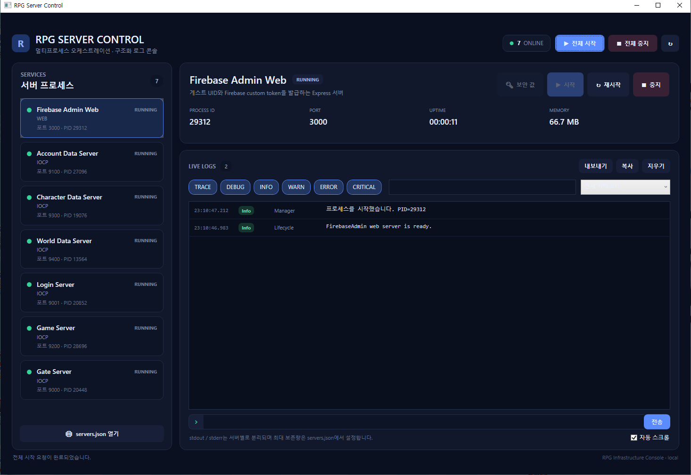
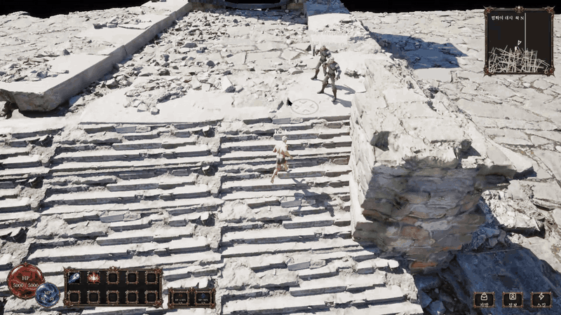
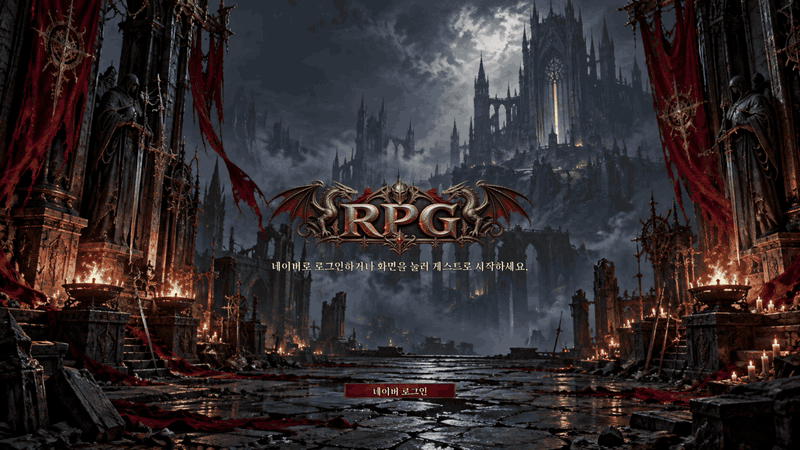
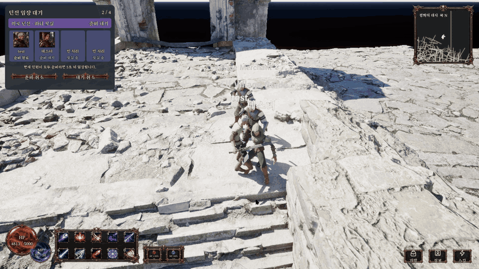
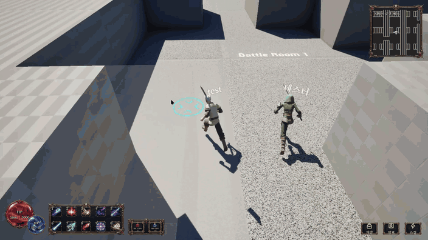
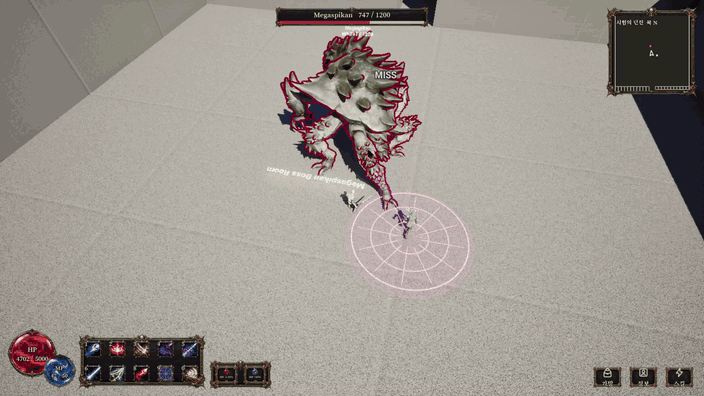
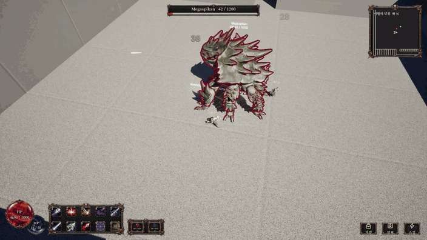

# 개인 RPG 프로젝트

UE 클라이언트, C++ IOCP 서버, Node.js 인증 웹을 연결한 개인 RPG 프로젝트입니다. 통신 서버를 기초부터 구성하고, 클라이언트의 요청이 여러 서버를 거쳐 게임 로직과 데이터베이스까지 이어지는 흐름을 구현했습니다.

[IOCP·워커](#learning-network) · [서버 통신·MySQL](#learning-tunnels) · [계정 인증](#learning-auth) · [멀티스레드 게임 로직](#learning-ownership) · [보스전](#learning-gameplay)

<strong>1. IOCP와 워커를 기초부터 구성하기</strong>

소켓 연결과 비동기 송수신, IOCP 완료 통지, 워커 스레드로 이어지는 기본 구조를 직접 구성했습니다. 연결된 클라이언트의 데이터를 어떤 워커가 받고, 받은 데이터를 어디로 전달할지 따라가며 공부했습니다.

패킷 직렬화·역직렬화도 직접 구현했습니다. 헤더에 패킷 종류와 데이터 크기를 넣고, 수신 버퍼에서 완성된 패킷을 꺼내 처리하도록 만들었습니다. 데이터가 중간에 나뉘어 도착하거나 여러 패킷이 붙어서 도착하는 경우도 처리했습니다.

송신 요청이 한 번에 전부 완료되지 않는 경우와 연결이 끊긴 뒤 남아 있는 비동기 작업도 함께 다뤘습니다. 정상적으로 통신하는 흐름에 더해, 작업이 끝나거나 실패했을 때 연결과 버퍼를 어떻게 정리해야 하는지 살펴봤습니다.

[IOCP·세션 코드](MyRpgServer/ServerCore) · [바이너리 프로토콜](MyRpgServer/ServerCore/BinaryProtocol.h) · [클라이언트 송수신 코드](Client/Source/RPG/Private/Managers/NetworkManagerModules)

<strong>2. 클라이언트·서버 통신과 MySQL 데이터베이스 구성</strong>

UE 클라이언트는 TCP로 GateServer에 연결합니다. GateServer는 로그인 요청을 LoginServer로, 게임 요청을 GameServer로 전달합니다. LoginServer와 GameServer는 필요한 데이터 작업을 별도 프로세스에 내부 TCP 요청으로 보냅니다. 여러 사용자의 요청이 같은 연결을 지나갈 때는 사용자와 요청을 구분해 응답을 연결하고, 연결이 종료되거나 서버가 재접속한 뒤 도착한 응답도 확인합니다.

**서버 실행 화면**

RPG Server Control에서 인증 웹, GateServer, LoginServer, GameServer와 데이터 서버 3개의 실행 상태와 로그를 확인할 수 있습니다.

**MySQL 구성**

계정, 캐릭터, 월드 정보를 세 스키마로 나누고, 각 데이터 서버가 담당 스키마의 SQL을 실행하도록 구성했습니다.

| 데이터 서버 | MySQL 스키마 | 저장하는 데이터 |
| --- | --- | --- |
| AccountDataServer | [`account_db`](MyRpgServer/database/schema.sql) | 계정 UID, 로그인 자격 증명 해시, 접속 상태 |
| CharacterDataServer | [`character_db`](MyRpgServer/database/character_schema.sql) | 캐릭터 목록·기본 정보, 골드, 가방, 장착 상태 |
| WorldDataServer | [`world_db`](MyRpgServer/database/world_schema.sql) | 맵 식별 정보, GameServer 가동 등록과 유효 시간 |

LoginServer는 계정 인증에 필요한 데이터를 AccountDataServer에, 캐릭터 목록과 생성 요청을 CharacterDataServer에 보냅니다. GameServer는 WorldDataServer에 가동 상태를 등록하고 주기적으로 갱신합니다. LoginServer는 캐릭터 선택 후 입장할 게임 서버의 가동 상태를 WorldDataServer에서 조회합니다.

**요청 흐름 시연 · 상점 구매와 장비 착용**

클라이언트가 GateServer를 통해 구매나 착용을 요청하면, GameServer가 게임 상태를 확인하고 CharacterDataServer에 저장을 요청합니다. CharacterDataServer는 구매 시 골드 차감과 가방 갱신을 하나의 트랜잭션으로 처리하고, 착용 요청에서는 장착 상태를 저장합니다. GameServer가 처리 결과를 돌려주면 클라이언트의 가방과 장착 UI가 갱신됩니다.

[Gate 중계 코드](MyRpgServer/GateServer/GateServer.cpp) · [상점·장비 저장 코드](MyRpgServer/CharacterDataServer/EconomyRepository.h) · [서버 실행 도구](MyRpgServer/ServerManager/README.md)

<strong>3. Firebase·소셜 로그인으로 계정 인증하기</strong>

외부 로그인 결과를 게임 계정 인증까지 연결해 보고 싶어 Firebase와 네이버 로그인을 사용했습니다.

웹서버가 네이버 인증 결과를 확인하고 Firebase Custom Token을 발급하면, 클라이언트가 Firebase SDK를 통해 ID Token을 받습니다. 게임 로그인 서버는 웹의 검증 API를 통해 토큰을 확인하고, 검증된 UID를 계정 데이터와 연결하도록 구성했습니다.

로그인 도중 취소하거나 응답이 늦게 도착하는 상황도 처리했습니다. 브라우저에서 시작한 인증 요청을 구분하고, 토큰 교환은 한 번만 허용하며, 만료되거나 취소된 요청의 결과는 사용하지 않도록 했습니다.

현재 인증 연결 코드와 자동 검사는 구현했으며, 실제 네이버 계정을 이용한 전체 로그인 흐름과 Android 실기기 검증은 남아 있습니다.

**게임 클라이언트 시연 · 로그인 화면에서 마을 입장까지**

[네이버 인증 웹 코드](FirebaseAdmin/naver-auth.js) · [Firebase 검증 코드](FirebaseAdmin/firebase-verifier.js)

<strong>4. 멀티스레드 게임 로직을 관리하고 디버깅하기</strong>

멀티스레드 게임 로직을 만들면서 가장 신경 쓴 부분은 어떤 스레드가 게임 상태를 바꾸는지 코드를 보고 알 수 있게 하는 것이었습니다.

맵마다 담당 워커를 정하고, 같은 맵의 상태는 해당 워커에서만 변경하도록 구성했습니다. 네트워크 워커는 패킷을 읽고 검증한 뒤 명령 큐로 전달하고, 실제 이동이나 전투 처리는 맵 담당 워커가 수행합니다. DB·HTTP 작업도 별도 워커에서 실행한 뒤 결과를 맵 담당 워커로 돌려보내도록 했습니다.

특정 캐릭터의 상태가 바뀌었을 때 요청을 받은 지점부터 명령 처리와 외부 작업 결과 반영까지 경로를 따라갈 수 있도록 나눴습니다. 동시에 들어오는 요청과 연결 종료를 처리할 때도 상태 변경의 기준을 유지하려고 했습니다.

요청이 쌓이는 상황을 다루기 위해 큐의 건수와 바이트 제한을 두고, 포화 상태에서는 새 요청을 거부하도록 만들었습니다. 과부하와 종료 상황에서 작업을 어떻게 다룰지도 함께 연습했습니다. 이 개인 프로젝트의 대규모 부하 성능은 아직 측정하지 않았습니다.

**게임 플레이 시연 · 2인 파티 던전 입장**

두 플레이어가 대기방에서 준비한 뒤 같은 던전에 입장합니다.

[맵 워커 배정](MyRpgServer/GameServer/Game/MapScheduler.h) · [게임 runtime](MyRpgServer/GameServer/Game/GameRuntime.cpp)

<strong>5. 보스전 행동과 전투 패턴 만들기</strong>

던전 안에서 보스가 이동하고 공격하며 플레이어가 공격을 보고 피하는 흐름을 구현했습니다.

보스는 강타·지면 공격·포효·투사체 등의 행동을 조합하도록 구성했습니다. 패턴의 선택 조건과 가중치, 행동 순서는 데이터로 나누고, 서버가 공격 범위와 피해를 판정하도록 했습니다. 클라이언트에서는 그 상태에 맞춰 공격 예고와 애니메이션·이펙트를 표시했습니다.

보스의 공격 외에도 전투방 진입 시 문을 닫는 처리, 플레이어 사망 후 재도전, 보스 처치 후 출구가 열리는 흐름을 연결했습니다. 보스전 전체를 하나의 콘텐츠로 만들어 보면서 전투 판정과 화면 표현, 전투 시작·종료 상태를 함께 다뤄봤습니다.

**일반 몬스터 전투 · 고블린 무리 처치**

파티원 두 명이 던전에서 기본 공격과 스킬을 사용해 고블린을 처치합니다.

**보스전 · 공격 예고와 대응**

바닥에 표시되는 직선·부채꼴·원형 공격 범위를 보면서 피하거나 반격합니다.

**전투 종료 · 보스 처치 후 마을 복귀**

[서버 전투 코드](MyRpgServer/GameServer/Game/GameWorldCombat.inl) · [던전 진행 코드](MyRpgServer/GameServer/Game/GameWorldDungeon.inl)

### 구현 코드와 참고 문서

[UE 클라이언트](Client) · [IOCP 서버](MyRpgServer) · [인증 웹](FirebaseAdmin)

[처음으로 ↑](#top)
